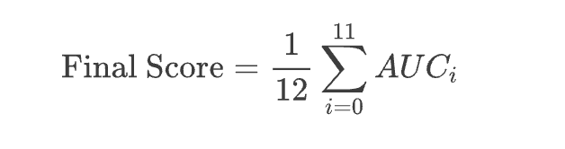

# RSNA-Knee-Abnormality-Detection

Practice solution for the Kaggle competition [RSNA Knee Abnormality Detection](https://www.kaggle.com/competitions/rsna-knee-abnormality-detection). The competition has ended; this repo is for learning.

> The Description, Evaluation and Dataset sections below are taken from the competition page.

## Description
The knee is the most commonly injured and imaged joint in the body. Osteoarthritis alone affects an estimated 654 million people worldwide, while acute knee injuries account for 15 to 40 percent of all sports-related trauma. MRIs show clinicians ligaments, cartilage, menisci, and bone in detail, without exposing patients to radiation.

Reading those scans isn’t always straightforward. ACL and MCL tears, meniscal damage, cartilage loss, fractures, and other abnormalities can be subtle, and radiologists don’t always interpret them the same way. Access to musculoskeletal radiologists is also limited, especially outside major medical centers, leading to delays and inconsistent diagnoses.

In this competition, you will develop multimodal machine learning models to detect twelve clinically important knee abnormalities. You'll work with the first RSNA AI Challenge dataset that pairs every imaging study with its original radiology report, enabling your models to learn from both visual scans and written diagnostic text.

High-performing models can act as robust decision support tools, delivering the accuracy, consistency, and speed needed to elevate expert-level knee MRI interpretation and improve care across disparate clinic settings.


## Evaluation
Submissions are evaluated by the average area under the ROC curve between the predicted confidence scores and the observed targets across the twelve targets:



The final score is, in other words, the macro-averaged AUC ROC.

## Dataset Description
This dataset contains knee MRI studies annotated for twelve common findings: ligament and meniscus injuries, three compartments of osteoarthritis, joint effusion, synovitis, Baker's cyst, bone contusion, and fracture. Each study comprises a collection of individual MRI sequences from a single scanning session formatted as DICOM series. Your task is to predict the per-study probability of each of the twelve findings.

Studies come from a diverse international mix of imaging sites and span a wide range of scanners, protocols, and populations. Only a small subset of training studies carry per-condition labels. We also provide the original text of the radiology report from which you may wish to derive the labels for the remaining studies.

## Files
`train.csv` One row per training study.

- `StudyInstanceUID` - unique identifier for the study; matches the folder name under `train_series/`.

- `Report` - the free-text radiology report. May be in any of several languages, depending on the reporting institution.

#### Twelve binary labels:

- ACL - anterior cruciate ligament injury (0/1).
- MCL - medial collateral ligament injury (0/1).
- Medial Meniscus - medial meniscus tear (0/1).
- Lateral Meniscus - lateral meniscus tear (0/1).
- Medial OA - osteoarthritis of the medial tibiofemoral compartment (0/1).
- Lateral OA - osteoarthritis of the lateral tibiofemoral compartment (0/1).
- PF OA - patellofemoral osteoarthritis (0/1).
- Effusion - joint effusion / excess fluid (0/1).
- Synovitis - inflammation of the joint lining (0/1).
- Baker's - Baker's cyst (0/1).
- Contusion - bone contusion / bone bruise (0/1).
- Fracture - fracture (0/1).

`train_series.csv` One row per training series. Each series is a single MRI acquisition and each study comprises several series.

- `StudyInstanceUID` - study this series belongs to.
- `SeriesInstanceUID` - unique identifier for the series; matches the folder name under `train_series/<StudyInstanceUID>/`.
- `Fluid_Sensitive` - 1 if the sequence emphasizes fluid signal (T2, PD, STIR, and similar), 0 otherwise.
- `Fat_Suppression` - 1 if the sequence applies fat suppression, 0 otherwise. Note that although `Fluid_Sensitive` and `Fat_Suppression` are often correlated, as observed in the training set, they are not necessarily equivalent for every case.
- `Anatomical_Plane` - imaging plane: `Sagittal`, `Coronal`, or `Axial`.

`train_series/` Training DICOMs, organized as `train_series/<StudyInstanceUID>/<SeriesInstanceUID>/<SOPInstanceUID>.dcm`. Each `.dcm` is a single image slice. Series typically contain 20–45 slices (median 30), with a long tail out to a few hundred.

`test.csv` Example test file with three study IDs from the public test set. During scoring, this example data will be replaced with the actual test data. There are about 1300 studies in the test set. The Report field will not be provided at the testing stage.

- `StudyInstanceUID` - unique identifier for a test study.

`test_series.csv` Same schema as `train_series.csv`, for the example test studies. Replaced with the real test-series descriptors during scoring.

`test_series/` Example test DICOMs, same layout as `train_series/`. Replaced with the real test DICOMs during scoring.

`sample_submission.csv` A valid submission with all label columns set to `0.5`.

## Dataset Distribution Notice

Although efforts have been made to ensure each abnormality is represented in each dataset, the prevalence of abnormalities is not guaranteed to be the same across the training, public leaderboard, and final evaluation datasets.

## DICOM Notes

Intensities, orientations, and resolutions vary across series and studies. Series come in a mix of transfer syntaxes (uncompressed Explicit VR Little Endian, JPEG Lossless, JPEG 2000, Implicit VR Little Endian). Every DICOM has been stripped to an allowlisted set of 86 metadata tags.

# Setup

The full dataset is large, so notebooks are written locally and **executed on Kaggle**, where the competition data is already mounted. Only the results are downloaded.

1. Accept the competition rules on the [competition page](https://www.kaggle.com/competitions/rsna-knee-abnormality-detection/rules).
2. Install the tools:
   ```bash
   python3 -m venv .venv && source .venv/bin/activate
   pip install kaggle pandas ipykernel
   ```
3. Create an API token (kaggle.com → Settings → API → Create New Token) and save it:
   ```bash
   mkdir -p ~/.kaggle && mv ~/Downloads/kaggle.json ~/.kaggle/ && chmod 600 ~/.kaggle/kaggle.json
   ```
4. Run a notebook on Kaggle and fetch its outputs into `outputs/<notebook>/`:
   ```bash
   scripts/kaggle_run.sh notebooks/01_eda.ipynb          # CPU
   scripts/kaggle_run.sh notebooks/01_eda.ipynb --gpu    # GPU
   ```
   The executed notebook comes back with all cell outputs. The run also appears under *Your Work → Code* on Kaggle.

Notebooks locate the data automatically: under `/kaggle/input` on Kaggle, or in `DATA_DIR` (default `data/`) when run locally with a small sample.

## Project structure

```
notebooks/            Jupyter notebooks (run on Kaggle via scripts/kaggle_run.sh)
scripts/kaggle_run.sh Push a notebook to Kaggle, wait, download outputs
outputs/              Results pulled back from Kaggle (git-ignored)
data/                 Optional local data sample (git-ignored)
docs/                 Images used in this README
```
